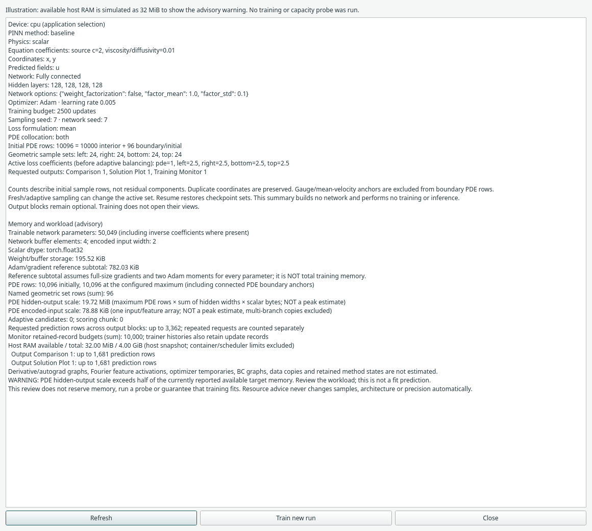

# Review memory and workload

Open **Run → Run summary…**, or click **Train PINN** / **F5**. The **Memory and
workload (advisory)** section combines the assembled graph's network, point counts
and output requests. Refresh after edits or when available memory changes.

*Illustration: the available host RAM is explicitly simulated as 32 MiB to show
an advisory warning. Network/workload figures come from the real graph. No
training, memory-exhaustion test or capacity measurement was performed.*

## Read the numbers

| Figure | Meaning |
| --- | --- |
| Trainable network parameters | Architecture arithmetic, including optional weight factorization and inverse coefficients; no network is constructed |
| Weight/buffer storage | Scalar storage for the configured network at the displayed default dtype |
| Adam/gradient reference subtotal | Weights, full-size gradients, two Adam moments and network buffers; assumes every parameter has those states, and excludes temporary allocations |
| PDE rows initially / at maximum | Counts include explicitly connected PDE boundary anchors; RAR uses its configured cap and importance sampling keeps its budget |
| Named geometric set rows | Sum of the named sets, distinct from PDE collocation selection |
| Hidden-output scale | Maximum PDE rows × sum of hidden widths × scalar bytes: one hidden-output array per layer, not the saved derivative graph |
| Encoded-input scale | Maximum PDE rows × encoded width × scalar bytes: one raw/feature array; full Fourier encodings can expand rapidly |
| Candidates / scoring chunk | Candidate pool size and the maximum chunk used for residual scoring |
| Prediction rows | Sum across requested output blocks; regular-grid counts are upper bounds for obstacle domains, supplied-cloud counts use exact rows |
| Monitor budgets | Retained record budgets across monitors; the numerical trainer also retains update history |
| Available RAM / VRAM | A point-in-time system/driver query, not a reservation or a fit guarantee |

Several output blocks can request the same locations independently; their rows
are counted separately. Parameter/buffer counts follow the actual supported
architectures. Memory figures use the current default scalar dtype used when a
new desktop network is built. They do not account for an already loaded
checkpoint with a different dtype.

These figures are **not total training or peak memory estimates**. Higher-order
autograd graphs, BC evaluation, optimizer temporaries, gated/multiscale branches,
data copies, SA masks, Scale frozen iterates and Expert NTK/teacher states can
add substantial demand. A small network can still exhaust memory when many
points require PDE derivatives. Histories/outputs also occupy host RAM.

The review builds no network, evaluates no residual and changes neither the
model nor trained results, Undo, samples or RNG state. It reuses Run summary's
existing sample preparation to count rows. A CUDA availability query may
initialize the CUDA context; it does not exercise the training workload.

## Understand an advisory warning

A warning appears when weight/buffer storage, the Adam reference subtotal, the
hidden-output scale or the encoded-input scale individually exceeds **half of the
currently reported available target memory**. This is an advisory review rule,
not an experimentally calibrated prediction or a new hard limit. Train remains
available for valid settings. No samples, architecture, precision or batch
semantics are changed automatically.

Host RAM figures do not include container, scheduler or process quotas. GPU
figures report driver-free memory; PyTorch may also reuse its own allocator cache.
Other programs can change availability immediately after the query. If a query
is unavailable, the review says so and does not invent a capacity estimate.

Existing numerical/configuration bounds still apply, including supported network
sizes, sampler budgets, RAR caps and evaluation-grid limits. A setting passing
those bounds does not establish that it will fit on this machine. Direct API/MCP
training keeps its existing validation; the resource summary is an explicit GUI
review, not a new global allocator policy.

## Recover from a memory-allocation failure

Recognized Python/Torch allocation failures in training and prediction produce a
stage-specific message in **Messages**, keeping the backend diagnostic available.

| Stage | Useful action |
| --- | --- |
| Model construction | For a new run, review network width/depth and Fourier feature counts |
| Checkpoint restore | Free memory or choose a suitable device; continuation requires compatible saved architecture/data/objective |
| Training update | For a new run, review active PDE/BC rows, network size, RAR maximum and candidate-scoring chunk |
| Output evaluation | Review output resolution/row count and output requests; training points are independent |

The failed worker releases its model/checkpoint references and produces no valid
new result. Controls become available again after the worker finishes. Previously
saved run files are unchanged; reopen a saved run if you need checkpoint
continuation. A failed optimizer update is not promoted to a valid checkpoint.
Ordinary non-memory errors keep their original diagnostic rather than being
mislabelled as resource failures. The program does not automatically retry a
smaller experiment or change its physics.

This first milestone handles exceptions Python receives. Workers still share
the GUI process: an OS-level memory kill, driver failure or uninterruptible
operation can still terminate or stall the application. Isolated worker processes,
OS/resource budgets and representative capacity probes remain planned work.

## Background references

The implementation is independent. These projects inform the next milestones:

- [Lightning batch-size finding](https://api.lightning.ai/docs/pytorch/stable/advanced/training_tricks.html) measures trial workloads rather than treating parameter counts as sufficient.
- [PhysicsNeMo recommended practices](https://docs.nvidia.com/physicsnemo/26.03/physicsnemo-sym/user_guide/theory/recommended_practices.html) describes gradient aggregation for memory-limited training; Margam does not silently introduce it into existing methods.
- [Ray OOM prevention](https://docs.ray.io/en/latest/ray-core/scheduling/ray-oom-prevention.html) motivates memory monitoring and worker failure containment.
- [PyTorch memory management](https://docs.pytorch.org/docs/stable/notes/cuda) distinguishes tensor allocations, allocator reservations and reusable cache.
