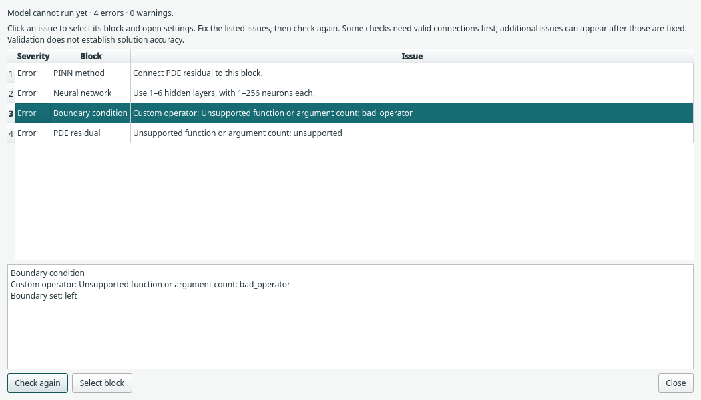
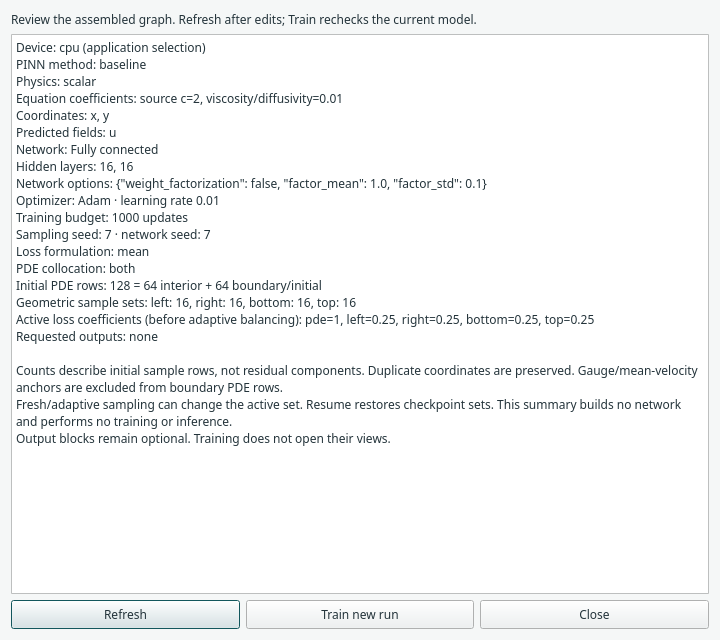
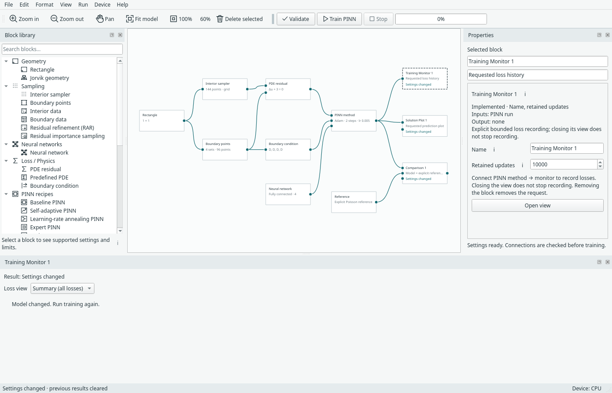
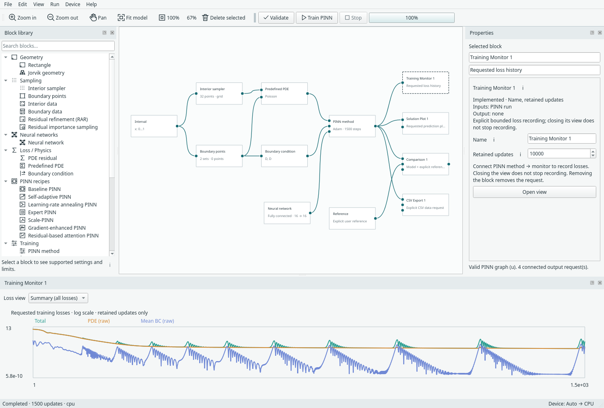
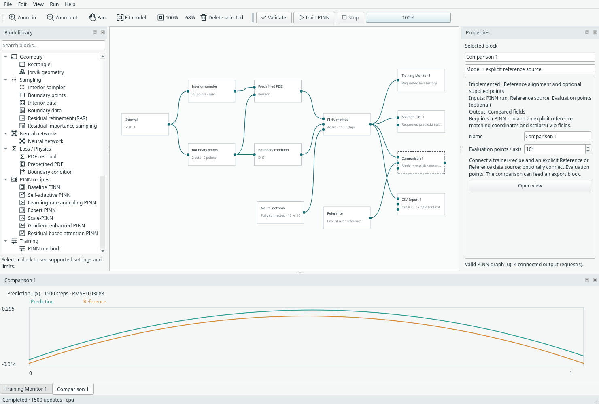
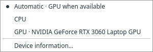
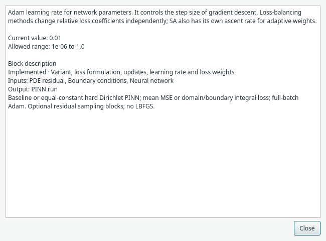
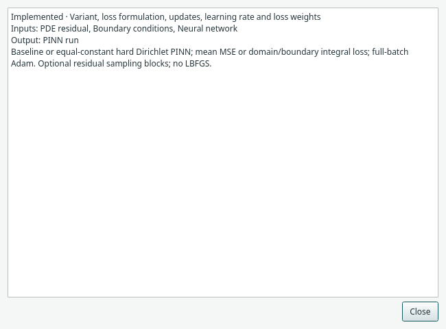

# Training and optional results

Click **Validate** before **Train PINN** (F5). Validation checks the supported
problem graph and settings. It does not establish that the trained solution will
reach a particular accuracy.

## Fix problems before training

Click **Validate** (or **Run → Validate model**, Ctrl+D) to open the **Model
validation** report. It collects independent missing connections, invalid
network/physics settings, boundary expressions, method compatibility and input
file issues instead of showing only the first failure.

*An actual graph with a missing PDE connection, invalid hidden layers and two
invalid physics expressions. No training, prediction or automatic repair was
performed while producing this report.*

Click an issue to select and centre its block and open the inspector. Boundary
issues select their named set where applicable; coupled-flow issues identify the
component and its target/operator. **Select block** provides the same action.
Project-wide issues may involve several components and have no single owner.
A removed block is reported safely rather than selected through a stale reference.

Fix the settings/connections, then click **Check again**. A model-change notice
marks older results as stale. Some cross-component checks need valid connections
first, so further issues may appear after those are fixed. The report deliberately
does not claim to enumerate every possible issue in an incomplete graph.

**Errors** prevent execution. **Warnings** identify additional declarations such
as unconnected optional output/data blocks, which the executor does not use.
The supported numerical execution checks remain required for Train and Evaluate;
no new trainer combinations are inferred from a passing report. Active data
issues also block execution early: missing or mismatched imported references and
prepared-domain plots without Evaluation points no longer wait until prediction
to fail. Successful validation does not establish numerical
accuracy or guarantee that checkpoint data identity still matches on resume.

The report does not change graph settings, files or undo history, clear existing
results, train a model, evaluate a network or open a numerical output pane.
[Project data overview](saving.md#inspect-the-projects-input-data) provides the
separate file inventory and session change warnings. Programmatic desktop checks
still return a boolean and do not open the report automatically; the explicit
Validate action opens it.

During training, progress and operational messages remain available. Stop requests
are checked between batches of 25 updates. A stopped partial run can retain
results and a checkpoint; changing the numerical model then invalidates them.

## Review the run

**Train PINN** or **F5** opens **Run summary**. You can also open it through
**Run → Run summary…**. Check the resolved application device, PINN method,
network, update budget, loss coefficients, requested outputs and initial PDE-row
counts. Choose **Train new run** to start. This starts fresh; the existing
**Resume checkpoint…** action remains the separate continuation workflow.

The summary reads the graph and initial sampling functions, including mapped
training files, without constructing or evaluating a network. It does not use
whichever block happened to be selected in the inspector. Counts distinguish
interior rows from connected boundary/initial PDE rows. Periodic partner rows are
included and gauge/mean-velocity anchors are excluded. Duplicate coordinates are
preserved; vector residual components do not multiply the displayed row count.

Fresh/adaptive samplers can change the set during training. Sequential Expert
counts describe the first physical-time window, and resume uses checkpoint sets.
The listed coefficients precede learned/adaptive balancing. Refresh after edits;
**Train new run** rechecks the current model before starting. Invalid/incomplete
models show a reason and disable training in the summary; use Validate for the
full issue report. Programmatic `start_training()` retains its direct, validated
execution contract without opening a dialog.

## Result freshness

Every output block and opened result view shows its in-memory availability:

| Badge | Meaning |
| --- | --- |
| Not run / Not connected | No results calculated for this output, or no source connected |
| Running / Evaluating | Training or inference is in progress |
| Current | Requested data belongs to the current in-memory model |
| Stopped / partial | A stopped run produced retained data; it may be incomplete |
| Settings changed | An edit invalidated and cleared the previous data |
| Failed | The requested job failed; consult Messages |
| Not available | The completed job produced no data for this request, such as an unfinished time-window schedule |

Moving blocks and renaming outputs preserve freshness. Numerical/graph changes
clear results as before and show **Settings changed**. New model definitions
start without results; run archives restore badges from the retained data.
Badges are runtime UI state and are not serialized into model definitions.
**Current** on an export block means prediction data is ready, not that a file
has been written. It also does not certify accuracy or unchanged external files;
use Project data overview for file checks and explicit export actions to write data.

## Ask for the views you need

| Block | What it requests | How to open |
| --- | --- | --- |
| Training Monitor | Recorded loss history | Double-click or Open monitor |
| Solution Plot | Predicted field values on an evaluation grid | Double-click or Open plot |
| Comparison | Predictions and an explicitly supplied reference | Connect both inputs, then Open comparison |
| CSV Export / ParaView Export | Evaluation data for an external file | Explicit export action after training |

The startup graph has no outputs. Complete examples wire useful optional outputs,
but their windows remain closed until opened. You can keep training without a
figure on screen. Closing a view is different from deleting its block.

*The block-owned monitor appears as a dockable results tab. [Open full size](../../assets/screenshots/manual-monitor.png).*

## Read the losses in context

The monitor's **Loss view** selector keeps the existing summary and lets you
select any named boundary, initial, periodic or gauge constraint. The selected
view shows **Raw** loss and **Weighted contribution** to the actual objective,
including the overall coefficient, per-constraint coefficient and any adaptive
trainer weighting. Values are measured before each update, including before SA
mask updates. Older records without weighted diagnostics show a labelled gap;
the monitor does not reconstruct them from today's settings.

Per-term PDE/constraint curves describe physical errors at training locations.
The total includes the configured method's weights; SA and LRA change their
objectives during training. A smaller total across two different methods need
not mean a better field solution. A reference is not required to see losses.

## Predictions and comparisons

Prediction resolution controls an independent regular evaluation grid. It does
not change the training samples. For scalar examples the existing plot views are
available. Coupled `u,v,p` results use tables and multi-column exports. A preview
table can show only the first rows while export includes the requested grid.

*An explicit scalar comparison tab; the reference is a separate graph input. [Open full size](../../assets/screenshots/manual-comparison.png).*

References can be supported presets, restricted expressions or mapped data, under
the documented contracts. An imported reference must match evaluation coordinates;
it is not silently interpolated from an arbitrary FEM mesh. The heat rectangle
reference is a labelled truncated series, not a universal exact solution.

**Next:** [Save or resume](saving.md), or [export predictions](export.md).

## Choose the application device

Use **Device → Automatic**, **CPU** or **GPU** once for the application. Automatic
uses CUDA when available and otherwise the CPU. The menu identifies the available
GPU and disables that choice when CUDA is unavailable. The status bar shows the
effective target. This preference is remembered locally and overrides older
per-block/model device values when a model is opened or an example is loaded.

Training, checkpoint continuation and inference all use the selection. Changing
it preserves trained weights; the next output evaluation reconstructs prediction
weights on the selected target without optimizer updates. It does not recompute
already displayed results automatically. Device changes are disabled while a job
or external geometry editor is running. Data preparation, geometry, tables and
file export continue on the CPU. The current GPU option uses the first CUDA
device; additional accelerator backends and per-GPU indexing are not implemented.

Command-line scripts retain their explicit `--device`/configuration options; this
menu is a desktop preference. Model/run archives continue to record numerical
configuration and the actual device used for recorded outputs.

## Read fuller setting descriptions

Click **i** beside an inspector setting or checkbox for an expanded description,
its current value, available dropdown choices or numeric limits, and the block’s
supported scope. The popup is scrollable and can stay open while you inspect other
settings. Common numerical, network and advanced trainer options have additional
explanations. Controls without a dedicated explanation show their current choices
or limits with the block context.

Use the block-header **i**, the block library’s **i**, or right-click **Help** to
read the full block description without fitting it into the narrow properties pane.

## Inspect selected error norms

Use a Comparison block's **Error norms…** action to select scalar fields or a
compatible vector group and inspect six discrete absolute/relative norms. Zero
reference norms have an explicit policy; field choices do not retrain the model
or change stored results. See [Error norms](error-norms.md) for definitions and the
reusable research-script function.
