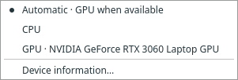
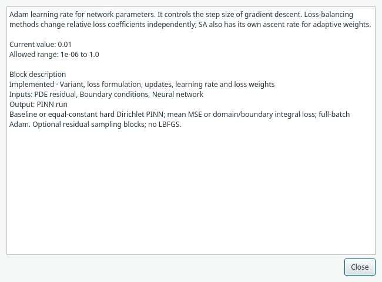
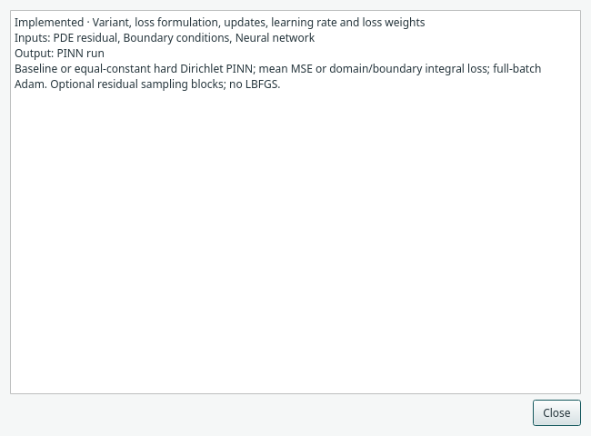

# Training and optional results

Click **Validate** before **Train PINN** (F5). Validation checks the supported
problem graph and settings. It does not establish that the trained solution will
reach a particular accuracy.

During training, progress and operational messages remain available. Stop requests
are checked between batches of 25 updates. A stopped partial run can retain
results and a checkpoint; changing the numerical model then invalidates them.

## Ask for the views you need

| Block | What it requests | How to open |
| --- | --- | --- |
| Training Monitor | Recorded loss history | Double-click or Open monitor |
| Solution Plot | Predicted field values on an evaluation grid | Double-click or Open plot |
| Comparison | Predictions and an explicitly supplied reference | Connect both inputs, then Open comparison |
| CSV Export / ParaView Export | Evaluation data for an external file | Explicit export action after training |

The startup graph has no outputs. Complete examples wire useful optional outputs,
but their windows remain closed until opened. You can keep training without a
figure on screen. Closing a view is different from deleting its block.

*The block-owned monitor appears as a dockable results tab. [Open full size](../../assets/screenshots/manual-monitor.png).*

## Read the losses in context

Per-term PDE/constraint curves describe physical errors at training locations.
The total includes the configured method's weights; SA and LRA change their
objectives during training. A smaller total across two different methods need
not mean a better field solution. A reference is not required to see losses.

## Predictions and comparisons

Prediction resolution controls an independent regular evaluation grid. It does
not change the training samples. For scalar examples the existing plot views are
available. Coupled `u,v,p` results use tables and multi-column exports. A preview
table can show only the first rows while export includes the requested grid.

*An explicit scalar comparison tab; the reference is a separate graph input. [Open full size](../../assets/screenshots/manual-comparison.png).*

References can be supported presets, restricted expressions or mapped data, under
the documented contracts. An imported reference must match evaluation coordinates;
it is not silently interpolated from an arbitrary FEM mesh. The heat rectangle
reference is a labelled truncated series, not a universal exact solution.

**Next:** [Save or resume](saving.md), or [export predictions](export.md).

## Choose the application device

Use **Device → Automatic**, **CPU** or **GPU** once for the application. Automatic
uses CUDA when available and otherwise the CPU. The menu identifies the available
GPU and disables that choice when CUDA is unavailable. The status bar shows the
effective target. This preference is remembered locally and overrides older
per-block/model device values when a model is opened or an example is loaded.

Training, checkpoint continuation and inference all use the selection. Changing
it preserves trained weights; the next output evaluation reconstructs prediction
weights on the selected target without optimizer updates. It does not recompute
already displayed results automatically. Device changes are disabled while a job
or external geometry editor is running. Data preparation, geometry, tables and
file export continue on the CPU. The current GPU option uses the first CUDA
device; additional accelerator backends and per-GPU indexing are not implemented.

Command-line scripts retain their explicit `--device`/configuration options; this
menu is a desktop preference. Model/run archives continue to record numerical
configuration and the actual device used for recorded outputs.

## Read fuller setting descriptions

Click **i** beside an inspector setting or checkbox for an expanded description,
its current value, available dropdown choices or numeric limits, and the block’s
supported scope. The popup is scrollable and can stay open while you inspect other
settings. Common numerical, network and advanced trainer options have additional
explanations. Controls without a dedicated explanation show their current choices
or limits with the block context.

Use the block-header **i**, the block library’s **i**, or right-click **Help** to
read the full block description without fitting it into the narrow properties pane.

