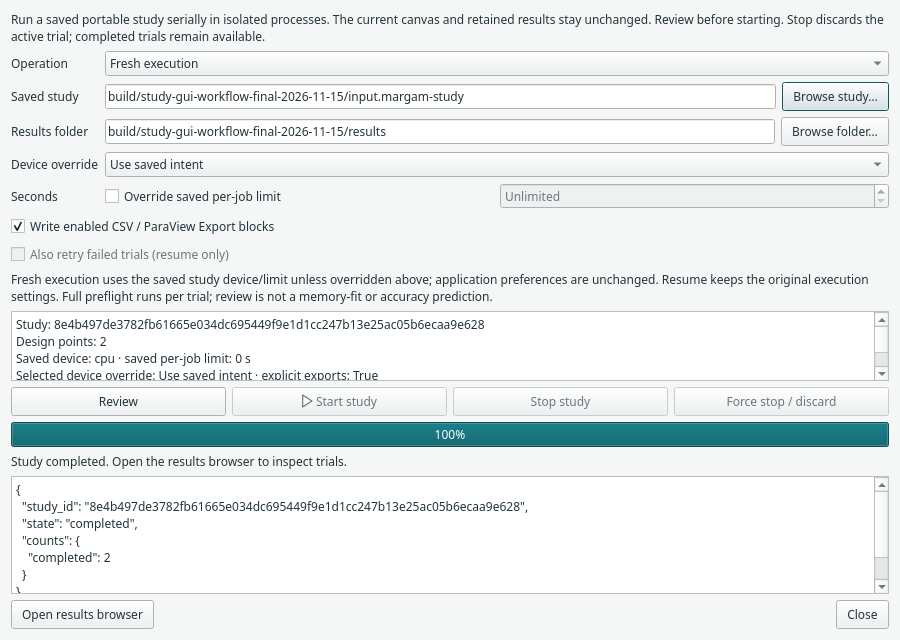

# Run a saved study from the desktop

Save a [portable parameter study](parameter-studies.md), then choose
**Run → Run saved study…**. This runs the existing serial CLI in a separate process;
your current canvas is not used as the study definition.

*Actual GUI-controlled CLI execution with owned reference inputs and explicit
exports. Two/three updates test software behavior, not solution accuracy.
[Open full size](../../assets/screenshots/manual-study-execution.png).*

## Fresh execution

1. Select **Fresh execution** and browse to the saved `.margam-study` file.
2. Choose a **new results folder**. The folder browser selects a parent and proposes
   a new `study-results` child; edit the name if it already exists.
3. Use the saved device/per-job limit, or explicitly override them. Enable separate
   CSV/ParaView export only if wanted; matching output blocks must be connected.
4. Press **Review**. It validates and freezes a private copy of the saved study,
   then shows its ID, design-point count, saved execution intent and input size.
5. Press **Start study**. Full graph/data/output preflight still happens per trial.
   Review is not a memory-fit or runtime prediction.

Changing any launch control invalidates review. Changes to the original study
file after review do not alter the private copy selected for this execution.
Application device/time preferences stay unchanged: this operation uses the
explicit saved-study settings/overrides shown in the dialog.

The canvas and numerical controls lock while the study runs, preventing overlapping
native jobs or geometry edits. Your model, Undo, retained results/weights and CPU
RNG remain unchanged. Progress counts design points and reports the active trial's
stage; it does not stream loss curves into current canvas blocks. The execution
log retains a bounded tail of CLI output.

## Stop, hide or resume

**Stop study**, or the main toolbar's Stop, asks the CLI to interrupt and reap its
active numerical job. Published earlier trials remain available; later trials stay
not started. **Force stop / discard** kills the owned study process group when a
normal stop is unresponsive. It can leave the last recorded state as `running`.
It never kills a process chosen from a results-file PID.

Closing this dialog while a job is active **hides the controls and keeps the job
running**. Reopen them through Run → Run saved study. Closing the main window first
stops the study, then performs its normal unsaved-model check. If the GUI process
disappears, an owner pipe interrupts the CLI; an isolated process-group hard-stop
fallback covers an unresponsive runner. This discards active work, not a checkpoint
recovery mechanism. Temporary files are controller-owned and removed after normal
or force-stopped execution while the controller survives.

To continue, choose **Resume existing results**, browse to that results folder,
and press **Review** again. Device, limit and export overrides are disabled:
[resume](study-cli.md#continue-the-grid) keeps the recorded execution settings.
Choose **Also retry failed trials** only when intended. Invalid/incompatible trials
stay recorded. The execution identity is checked again under the results-folder
lease before resume; changed reviewed execution metadata is refused.

Unfinished attempts restart **fresh**. Completed publications are verified and
preserved, and prior attempts stay in their original directories. No partial
optimizer state is recovered. Resuming requires unchanged recorded source/runtime
and device settings; use a new execution for a different experiment.

## Inspect the results

After the process exits, choose **Open results browser** to
[collect reported outcomes and verify/open a completed trial](study-results.md).
Nothing is automatically loaded into the canvas and no default plots appear.
For remote execution use [Slurm export](slurm.md); this dialog does not submit jobs.

This first controller supports POSIX process groups (Linux/macOS) and one serial
study at a time. Parallel CPU/GPU scheduling, mid-trial checkpoint recovery and
Slurm preemption remain separate work. OS resource quotas are not provided here.
