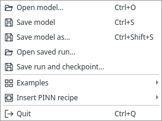
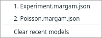
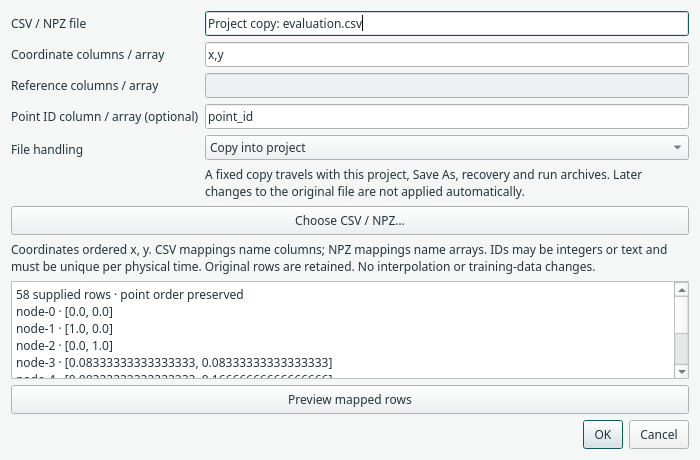
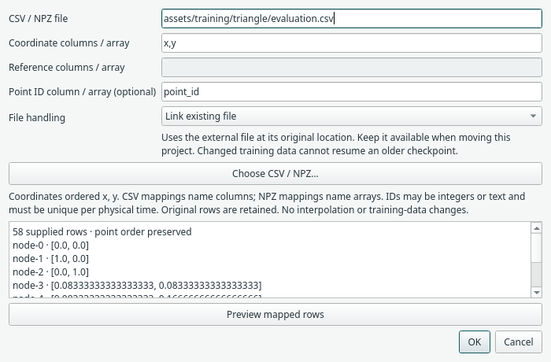
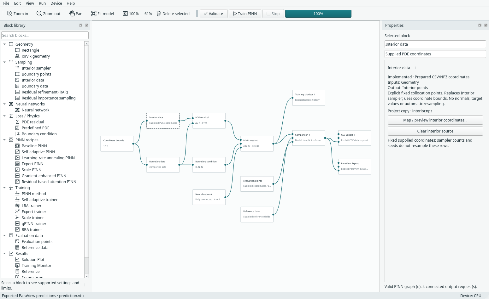
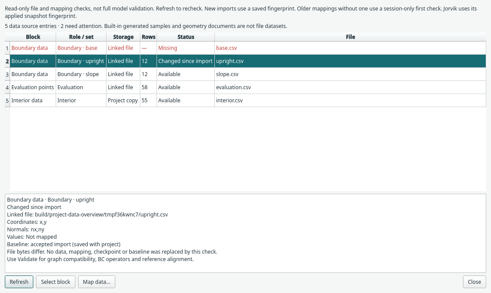

# Save, reopen and resume

A model definition and a trained run are different files. Save the one you need;
use both if you want an editable setup and a recorded training snapshot.

| File | Contains | Command |
| --- | --- | --- |
| `.margam.json` | Graph, block IDs, settings, connections, positions and plain-text notes | File → Save model / Save model as |
| `.margam-run.pt` | Model, requested results, monitor records and training checkpoint | File → Save run and checkpoint |
| `.csv` / `.vti` | Explicitly exported predictions | Connected export block's action |

{ .portrait }

*After training, File provides separate model and run/checkpoint actions. [Open full size](../../assets/screenshots/manual-save-menu.png).*

## Reopen a setup

Choose **File → Open model…**. It restores the graph and settings. It does not
load trained weights or recreate old predictions. Loading another setup uses the
normal Save / Discard / Cancel check for your current unsaved work.

## Recent models

**File → Recent models** lists the ten most recently opened or saved model
files. A successful open moves a model to the top. Hover an entry to see its full
local path when names match. Normal Save / Discard / Cancel protection still applies.
Failed or cancelled operations do not add entries. The menu is unavailable while
training or editing geometry.

If a file moved or is unavailable, Margam offers to remove its entry. Declining
keeps it for later (for example, a disconnected drive). **Clear recent models**
clears only the list. Neither action deletes a model or its companion data.
The list is stored in local desktop preferences, separately from shared model
files and run archives. Run archives use their existing separate Open command.



## Continue a trained run

Choose **File → Open saved run…**. Result views stay closed until requested.
Use **Run → Resume checkpoint…** to add more training updates. The archive carries
the state required by its method, including SA masks or LRA balancing history.

Resume validates architecture, optimiser settings and input-data identity.
Changing imported files, the architecture or numerical settings is not silently
accepted as the same run. Copied inputs are included in new run archives; linked
CSV/NPZ files must remain available for actual resume. Archived predictions can
still be viewed if external input files moved.

## What undo and layout remember

Undo/redo changes model definitions; it does not certify old results after a
physics change. Numerical edits clear stale results/checkpoints. Moving blocks or
renaming outputs preserves the trained result. Desktop layout/recovery preferences
are stored separately from your model; no result view opens from layout recovery.

For exact formats and validation rules, see [desktop persistence](../ui-prototype.md)
and [validation scope](../validation.md).

**Next:** [Export predictions](export.md).

Adaptive sampler runs also retain active points, importance weights and the sampling
schedule. Resume verifies the original data and settings; it does not restart the
sampler. See [adaptive sampling and resume](../adaptive-sampling.md#saved-models-and-runs).

## Project-owned files

Unsaved models have a private temporary working folder, created only when a
component needs files. First Save copies these files beside the model into
`<name>_files`; Save As copies them for the new model and preserves the original.
Keep the model and its companion folder together when moving a project.
Ordinary models without owned files do not create an empty companion folder.
A failed save retains the temporary working files so saving can be retried.
Discarding or closing the model removes its temporary working folder.

[Jorvik geometry documents](../jorvik.md) and their NetCDF snapshots use this owned
folder. Their paths are stored relative to the project workspace. CSV/NPZ files
can also be copied there when importing; existing links remain external unless
you explicitly change File handling. Desktop recovery copies owned files alongside
the recovery model; it pauses during external editing and resumes when the editor
closes. Close Jorvik before saving, switching projects or closing Margam.


## Choose copied or linked input data

Every CSV/NPZ mapping dialog now has **File handling**:

| Choice | Behaviour |
| --- | --- |
| **Copy into project** | A fixed snapshot travels with the model's companion folder, Save As, recovery and run archives. Changes to the original file are not applied automatically. |
| **Link existing file** | The project reads the file at its external location. Keep that file available when moving the project or resuming training. |

New sources default to **Copy into project**. Existing linked sources keep
**Link existing file** when reopened, so upgrading or previewing an old model
does not silently copy or replace its inputs. Choose Copy explicitly to convert
one. Preview the mapping and click **OK** to apply it. Cancel and failed
validation leave the mapping unchanged and do not install a new dataset.



*The file field identifies a project copy by name; no temporary folder path needs
to be managed by the user. The mapping and data readers are unchanged.*



The choice applies independently to interior points, each named boundary set,
evaluation points, Reference data and the older Reference block's imported values.
CSV and NPZ contents are copied intact; coordinate/normal/value/ID mappings are
preserved. The inspector shows **Project copy** or **Linked file**, with the linked
location shown explicitly. To replace a copied snapshot with newer data, browse
the desired original file and apply Copy again. To create a link from a copied
source, choose an external file and select Link; Margam will not create a fragile
absolute link into its own temporary folder.



Save a copied-data model and move **both** `<name>.margam.json` and `<name>_files`.
Save As copies the owned data for the new model and retains the originals. It
preserves trained weights for evaluation without extra optimizer updates.
Opening a run archive restores copied inputs into a private workspace, allowing
resume without the original model folder. Linked inputs remain external and are
not silently bundled. Existing model/archive formats remain readable.

Each imported file is limited to 64 MiB, including the existing expanded-NPZ
checks. Run archives retain their 256 MiB/4096-file limits. Copies retained for
undo/redo are kept in the workspace; automatic pruning is not implemented.
Copy/paste of blocks containing owned files remains disabled. CLI configuration
continues to use explicit ordinary file paths; this copy/link choice belongs to
the desktop project workflow.

### Reproduce the portability check

```sh
.venv/bin/python -m examples.portable_data --device cpu
.venv/bin/python -m examples.portable_data --device cuda
```

Each command leaves a fresh `run-*` folder below `build/portable-data` and prints
its location. Open `portable.margam.json` with its companion folder to inspect the
finished model. The check copies six training/evaluation/reference sources,
deletes the originals, verifies recovery, saves twice without changing weights,
relocates and trains the model, then restores/resumes a run archive after removing
the relocated model's inputs. Continuation matches uninterrupted training exactly
on the same device. It also checks reference alignment, original point IDs/order,
and CSV/VTU export. See the [CPU record](../../assets/benchmarks/portable-data-cpu.json)
and [CUDA record](../../assets/benchmarks/portable-data-cuda.json). This is a
portability check, not a solution-accuracy benchmark.


## Inspect the project's input data

Open **View → Project data overview…** before training or sharing a model.
The window lists file mappings held by the blocks, including disconnected source
blocks and individual named boundary sets. Generated built-in samples, analytical
reference expressions and geometry documents are not imported datasets.



*Actual triangle example: one copied interior source, three boundary mappings and
an evaluation source. One linked boundary file was removed and another changed
since its accepted import, detected after reopening the saved project. The overview leaves the model and datasets unchanged.*

| Display | Meaning |
| --- | --- |
| Block / Role or set | The owning block and its interior, named boundary, evaluation or reference role |
| Storage | Project copy or linked external file |
| Rows | Current mapped row count, when the file and mapping can be read |
| Available | The current file can be read using this mapping; not a claim of solution accuracy or complete graph validity |
| Missing / Unreadable | The referenced file is absent or cannot be opened |
| Invalid / unavailable | The reader rejected the file, mapping or current coordinate/field contract |
| Changed since import | File bytes differ from the fingerprint recorded when this mapping was explicitly accepted |
| Changed since first check | An older mapping has no saved fingerprint; its bytes differ from the first check in this session |
| Changed from applied Jorvik snapshot | File bytes differ from the fingerprint saved when that geometry's samples were applied |
| Not mapped | An explicit data-source block has no file mapping yet |

Select a row to inspect its location and coordinate, normal, value and ID mappings.
Reference mappings also show the model's field order. A shared file can appear
more than once because each set or block may map different arrays/columns.

- **Refresh** checks the current files. It does not watch the disk continuously,
  replace data, accept changed bytes, rewrite mappings or clear trained results.
  The ordinary baseline stays fixed on subsequent refreshes, including after Save As.
- **Select block** selects and centres the owner in the graph and opens its inspector.
  Named boundary rows select that boundary set too. Double-clicking a row does this.
- **Map data…** opens the existing mapping dialog. For Jorvik NetCDF inputs,
  **Review Jorvik datasets…** uses the geometry block's normal explicit update flow.
  These editing actions are disabled during training/external editing, and until
  Refresh when graph/settings changes make the table stale.

Newly accepted CSV/NPZ mappings record an **import fingerprint**, saved with the
project and run archive. A changed linked file can therefore be identified after
closing and reopening Margam, including on the first check. This applies to
training, each boundary, evaluation and reference mappings, for both copies and links.

Existing models without a recorded fingerprint retain the **session-only** fallback.
Their selected-row details explicitly say there is no saved import fingerprint;
Margam does not invent a baseline for bytes it never observed. To establish one,
open the mapping dialog, preview the file and click OK. The fingerprint describes
that accepted version, not an unverifiable earlier import.

To accept newer bytes deliberately, reopen the existing mapping dialog, preview
and apply it again. Mapping and fingerprint are one undoable edit. Refresh,
Validate, Save and reopening an archive do not accept changed bytes. Save As and
moving owned project files preserve the baseline. A fingerprint is bound to the
exact mapping; changing its file/columns through other APIs does not reuse an old
fingerprint for a different declaration.

A byte-change warning may reflect formatting-only changes; it does not establish
that coordinates or fields changed numerically. Valid changed files produce a
warning and can be used for a fresh training run. Strict checkpoint continuation
still compares actual numerical data independently. Reaccepting a training input
clears cached training/prediction state, even when its external pathname stays the
same. Jorvik retains its stricter applied-snapshot fingerprint checks.
Missing copied files are reported without recreating an empty working folder.

Use **Validate** for graph compatibility, boundary operators and reference
alignment. Resume retains its separate strict checkpoint/data identity checks.
The overview is a file and mapping diagnostic; it does not train, evaluate a
network, open a result view or automatically repair dependencies.


Canvas notes are model-owned presentation data (model format 29). Blank and
notes-only models are valid saveable drafts even though they cannot train.
Grid/snapping and dependency-highlight mode are local desktop preferences and
are not added to shared model/run configuration. Notes contain no numerical
parameters and editing them preserves cached results.
