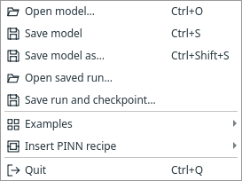

# Save, reopen and resume

A model definition and a trained run are different files. Save the one you need;
use both if you want an editable setup and a recorded training snapshot.

| File | Contains | Command |
| --- | --- | --- |
| `.margam.json` | Graph, block IDs, settings, connections and positions | File → Save model / Save model as |
| `.margam-run.pt` | Model, requested results, monitor records and training checkpoint | File → Save run and checkpoint |
| `.csv` / `.vti` | Explicitly exported predictions | Connected export block's action |

{ .portrait }

*After training, File provides separate model and run/checkpoint actions. [Open full size](../../assets/screenshots/manual-save-menu.png).*

## Reopen a setup

Choose **File → Open model…**. It restores the graph and settings. It does not
load trained weights or recreate old predictions. Loading another setup uses the
normal Save / Discard / Cancel check for your current unsaved work.

## Continue a trained run

Choose **File → Open saved run…**. Result views stay closed until requested.
Use **Run → Resume checkpoint…** to add more training updates. The archive carries
the state required by its method, including SA masks or LRA balancing history.

Resume validates architecture, optimiser settings and input-data identity.
Changing imported files, the architecture or numerical settings is not silently
accepted as the same run. Keep referenced input CSV/NPZ files available for actual
resume. Archived predictions can still be viewed if external input files moved.

## What undo and layout remember

Undo/redo changes model definitions; it does not certify old results after a
physics change. Numerical edits clear stale results/checkpoints. Moving blocks or
renaming outputs preserves the trained result. Desktop layout/recovery preferences
are stored separately from your model; no result view opens from layout recovery.

For exact formats and validation rules, see [desktop persistence](../ui-prototype.md)
and [validation scope](../validation.md).

**Next:** [Export predictions](export.md).

Adaptive sampler runs also retain active points, importance weights and the sampling
schedule. Resume verifies the original data and settings; it does not restart the
sampler. See [adaptive sampling and resume](../adaptive-sampling.md#saved-models-and-runs).

## Project-owned files

Unsaved models have a private temporary working folder, created only when a
component needs files. First Save copies these files beside the model into
`<name>_files`; Save As copies them for the new model and preserves the original.
Keep the model and its companion folder together when moving a project.
Ordinary models without owned files do not create an empty companion folder.
A failed save retains the temporary working files so saving can be retried.
Discarding or closing the model removes its temporary working folder.

[Jorvik geometry documents](../jorvik.md) and their NetCDF snapshots use this owned
folder. Their paths are stored relative to the project workspace. Existing external
CSV/NPZ references remain external. Desktop recovery copies owned files alongside
the recovery model; it pauses during external editing and resumes when the editor
closes. Close Jorvik before saving, switching projects or closing Margam.
