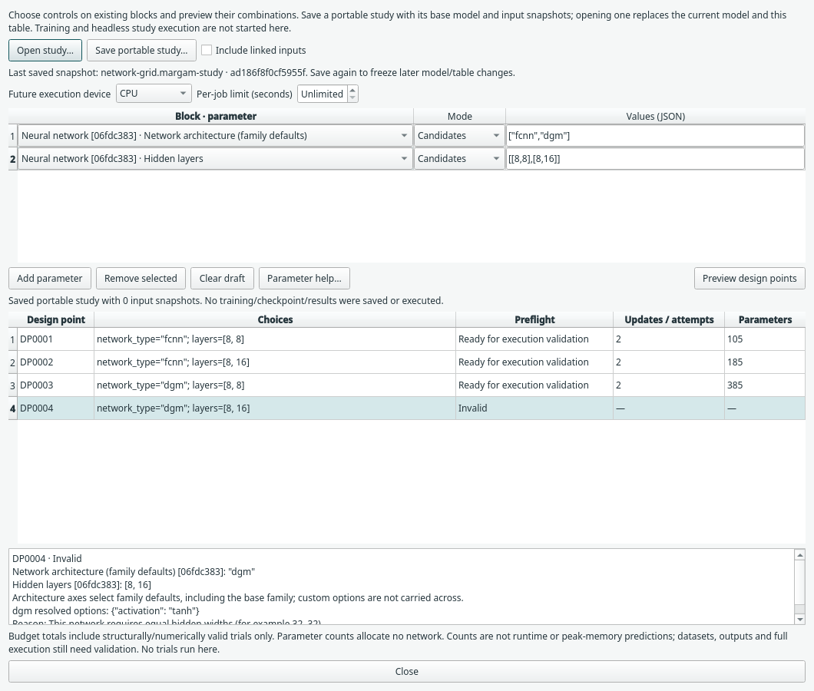

# Compare network families in a study

In **Run → Parameter study…**, add **Network architecture (family defaults)** on
the connected Neural network block, or on a compact PINN recipe that owns it.
Choose **Candidates** and enter architecture keys as a JSON list:

```json
["fcnn", "fourier", "siren"]
```

**Fixed** accepts one JSON string, such as `"siren"`. Numeric ranges are disabled
for this parameter. Parameter help lists the current supported pointwise network
keys. Neural operators and arbitrary Python architecture imports are not added.



*Actual four-trial preview: fully connected/DGM crossed with equal/unequal hidden
widths. The unsupported DGM width combination keeps a reason and no workload count.
[Open full size](../../assets/screenshots/manual-study-networks.png).*

## Defaults are an explicit part of the choice

**Every selected family uses its family-option snapshot, including a choice that
matches the base family. Custom base options are not carried across.** This prevents
SIREN, Fourier or affine-input settings leaking into another architecture.
Layer widths and network seed stay shared unless you sweep them separately.

For a new draft the snapshots start from current library defaults. Preview details
show the actual resolved options. Saving a study freezes them in its version-2/3
manifest. Reopening, previewing, executing and resaving that study preserves those
values even if library default values later change. **Clear draft** removes the
saved family snapshots as well as its parameter rows; newly added choices then use
current library defaults. Adding a new family uses current defaults for that new
family while preserving existing saved families.

If you want to keep a custom Fourier map, SIREN frequency, random weight
factorization or paper-specific settings on the base network, **omit the architecture
axis** and sweep widths/rates/seeds instead. This first architecture axis does not
provide a GUI editor for different custom options per family. It is not a claim
that family defaults reproduce any paper's architecture or accuracy.

## Preview, save and run

You can combine architecture choices with existing numeric/layer axes. The same
bounded Cartesian expansion applies: up to eight axes, 64 values per axis and
512 trials. Preview computes parameter counts without creating networks or samples.
Equal-width requirements and other existing network/configuration checks still
apply. Invalid combinations retain reasons and no budget/metric; valid trials
continue during execution.

Save a portable study, then use [desktop execution](run-study.md), the
[CLI](study-cli.md) or [Slurm export](slurm.md). Actual network options/configurations
are retained per trial, together with code/runtime provenance and native archives.
Use the [results browser](study-results.md) to inspect outcomes and verify/open a
completed trial. Different families can have different parameter counts and costs;
equal widths/update counts are not equal compute or accuracy protocols.

Cartesian numeric-only studies remain **version 1**, with their previous identities and
custom base options unchanged. Cartesian architecture studies use **version 2**; older
readers reject this version rather than ignoring its frozen settings. See the
[format contract](../study-format.md). Source/runtime compatibility checks for resume
remain unchanged. Configured recipe/trainer/optimizer/topology alternatives are
separate future work.

[Paired mode](parameter-studies.md#choose-how-lists-combine) instead matches list
positions and uses version 3, with the same frozen family-option policy.
