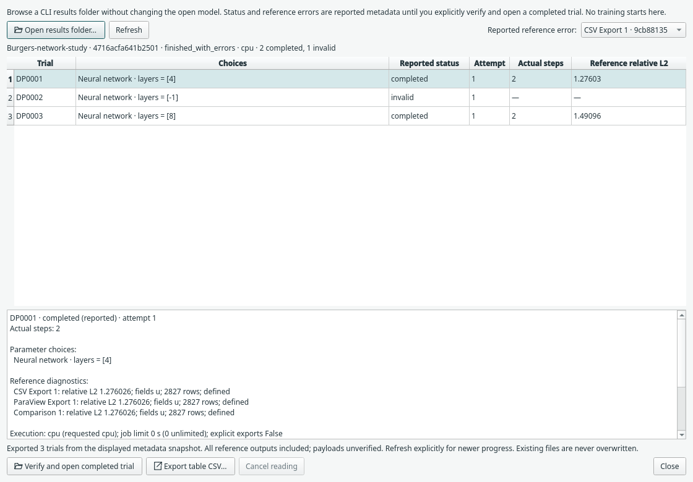

# Collect a study's results in Margam

After running a [saved study from the CLI](study-cli.md) or an
[exported Slurm job](slurm.md), choose **File → Open
study results…**, then **Open results folder…**. Select the folder containing
`summary.json`, `execution.json` and `study.margam-study`. Copy the whole results
folder back from a remote machine before opening it; no remote connection is
required. Version-2 results are supported. Older run archives can still be opened
individually with **File → Open saved run…**.

*Real CLI outcomes from a small Burgers network study: two valid trials and an
invalid network choice. Two updates test the workflow, not solution accuracy.
[Open full size](../../assets/screenshots/manual-study-results.png).*

## Review reported outcomes

Browsing preserves your current model, Undo history, trained weights, device
preference and files. It starts no training and loads no neural networks. You can
browse runs made with different recorded source versions or devices; those strict
runtime matches are required for **CLI resume**, rather than historical inspection.

Select a row to see its parameter choices, failure reason, previous attempts and
recorded runtime. **Refresh** explicitly rereads progress. There is no file watcher
or automatic retry. Reported `running` can be stale after a killed runner.

The reference-error selector chooses an output block's recorded discrete relative
L2 diagnostic. A dash means that trial has no completed diagnostic for the chosen
output. Undefined zero-reference errors retain their explicit status. Details
include the selected fields and row count. Margam does not rank trials or assume
that errors from different fields, units, coordinates or problems are comparable.

## Export the reported table

Press **Export table CSV…** and choose a new filename. Every design point is
exported in original order, including failed, invalid and unfinished trials.
The export includes **all** recorded reference outputs, regardless of which one
the table's error selector currently displays. Existing files and symlinks are
refused; choose another name. The results folder itself is unchanged.

This exports the **displayed metadata snapshot**. It does not refresh progress,
load archives, verify payload hashes or rank trials. Each row records the study
identity, snapshot summary checksum, reported study/trial status, attempt number,
actual completed steps, device and recorded source/runtime. Empty steps and
metric values mean absent or undefined, never an invented zero. Refresh before
exporting if you want newer progress. Export is disabled during reading and after
a failed refresh.

CSV format version 1 uses one row per trial:

| Columns | Meaning |
| --- | --- |
| `csv_version`, `metadata_scope` | Version 1; `reported_snapshot_payloads_unverified` |
| `study_id`, `summary_sha256`, `study_state` | Frozen study and displayed progress identity/status |
| `design_point`, `trial_id`, `reported_status`, `attempt`, `actual_steps` | Original trial identity and outcome |
| `choices_json`, `reason_json`, `attempt_history_json` | Exact choices, reason and previous attempt metadata as JSON |
| `device`, `requested_device`, `source_sha256`, `runtime_json` | Recorded execution provenance; runtime text is JSON |
| `metric:<output-id>:value` | Reported relative L2, or empty |
| `metric:<output-id>:status_json`, `norm`, `fields_json`, `rows` | Diagnostic status, norm, fields and row count under the same prefix |

Arbitrary text cells use JSON, retaining quotes/newlines and preventing text from
becoming spreadsheet formulas. Decode `*_json` cells with a JSON reader to recover
their original values. Missing diagnostics have empty cells; an explicitly
undefined diagnostic retains its JSON status and fields with an empty value.
A zero value remains `0`, distinct from missing. Files use UTF-8 with a header,
standard CSV quoting and a 32 MiB export limit. No physical compatibility, units
or accuracy are inferred from matching columns.

## Open one completed trial

Select a completed row and choose **Verify and open completed trial**. Margam
checks the frozen definition, execution record, published model/configuration and
all payload hashes, then makes a verified private copy of the native run archive.
Changed progress requires a refresh; changed, missing or unsafe files are refused.
Browsing alone reports metadata and does not verify all numerical payloads.

The normal saved-run workflow then asks about unsaved model changes and restores
that trial's owned inputs, weights and explicit outputs. The application's device
preference stays yours. Open individual block views as needed; no default plots
appear. You can continue the loaded checkpoint through the existing Resume action.

Reading and hashing run in the background. **Cancel reading** or closing the
browser stops the read without changing the model or result folder. Opening is
disabled during a training job or geometry edit and checked again before model
replacement. Compare two–eight explicit native archives against A through [View → Compare saved predictions](compare-runs.md).
For recorded curves use [saved training-history overlays](compare-histories.md).
This browser is read-only: further grouped execution and multi-run plotting
and Slurm submission/collection automation remain separate TODOs.
