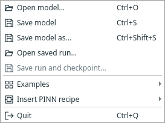
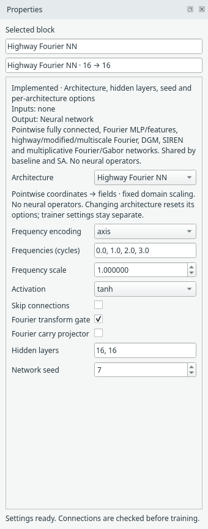
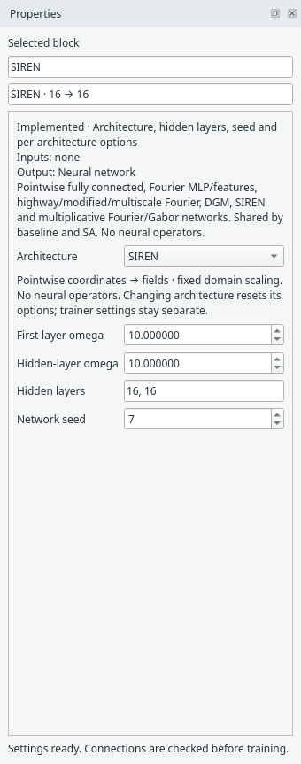
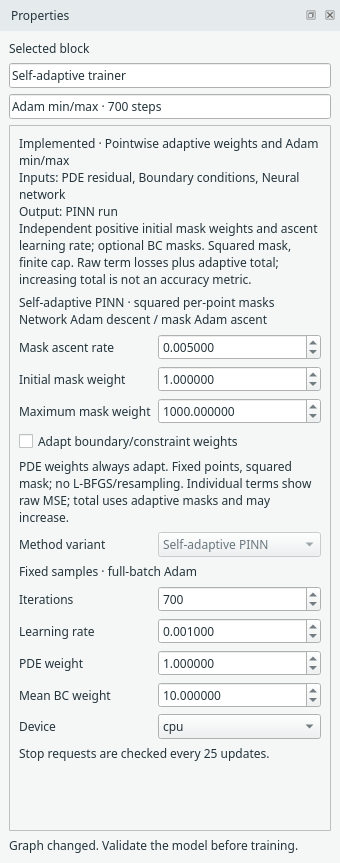
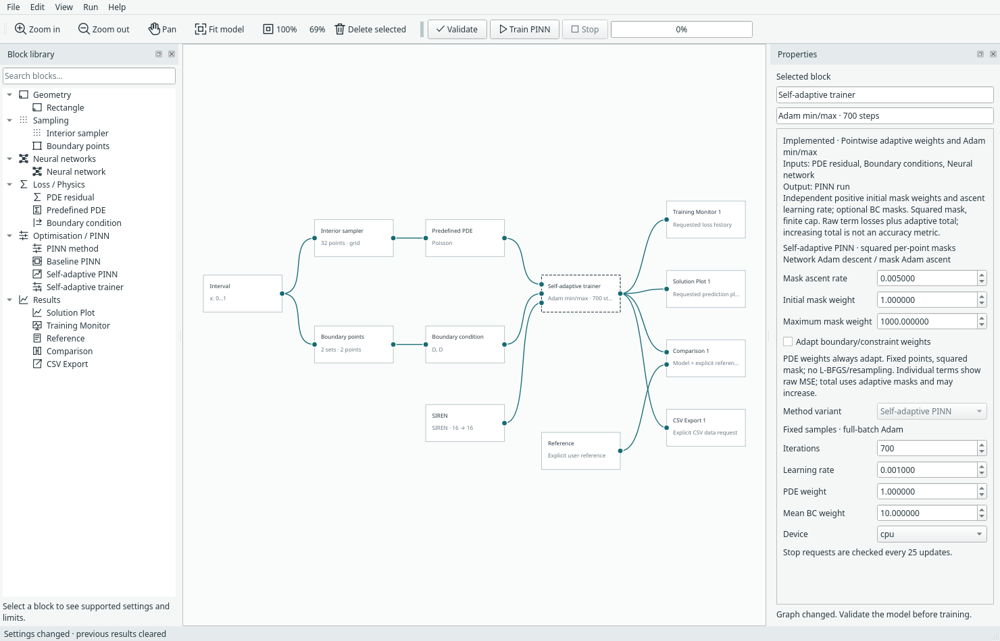
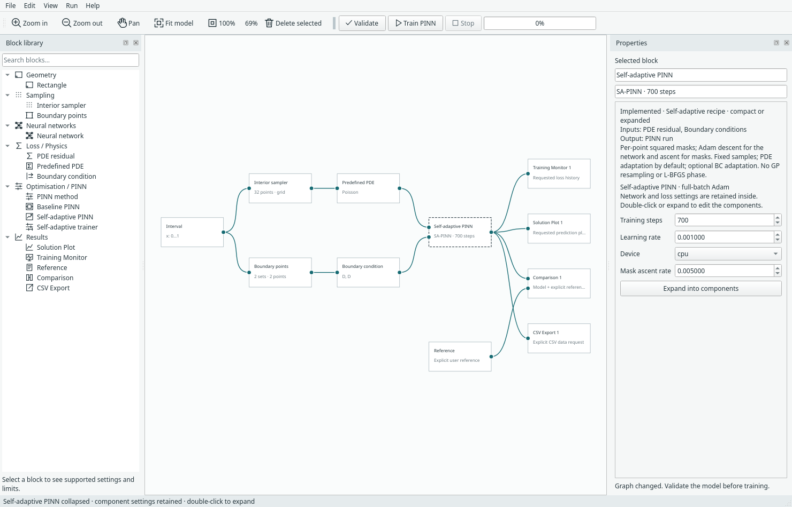
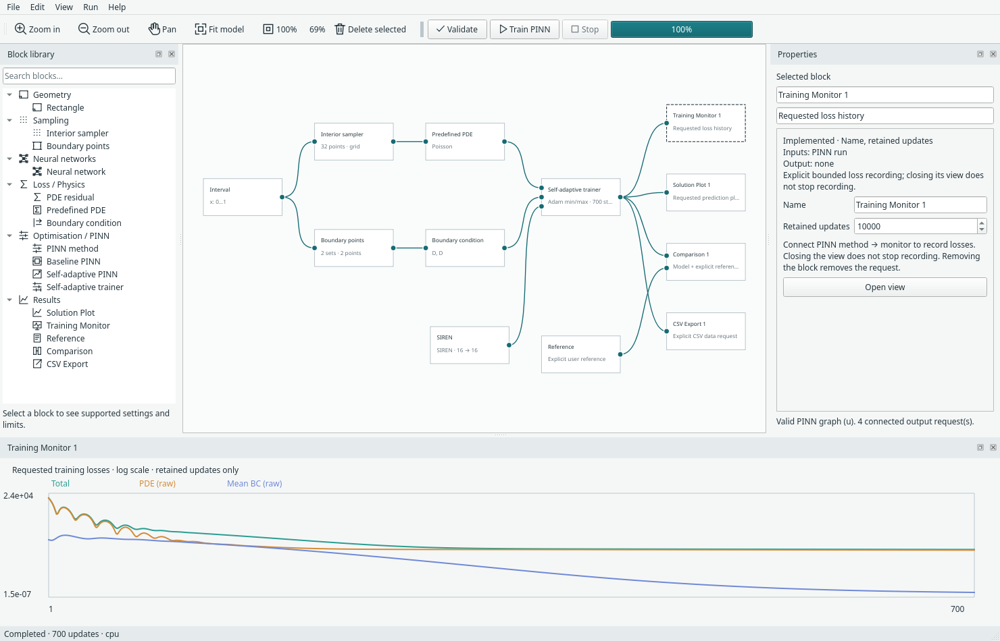
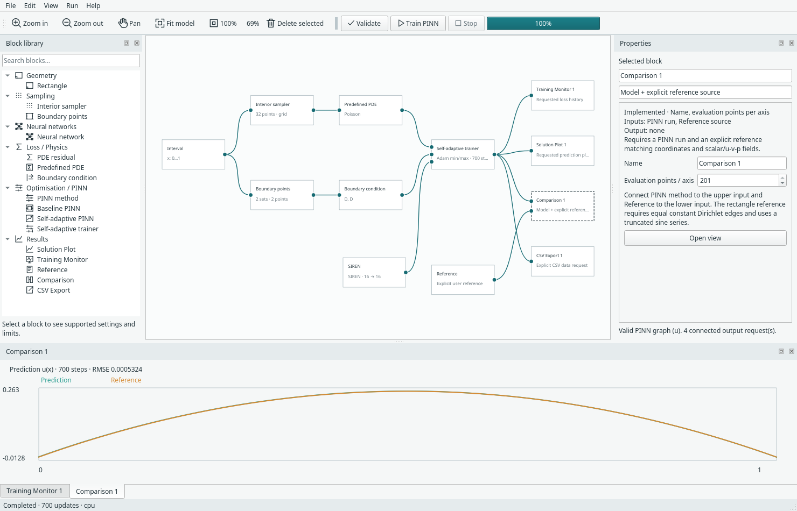

# Illustrated walkthrough: choose a network and train a PINN

[Documentation index](README.md) · [Network details](neural-networks.md) ·
[Desktop reference](ui-prototype.md) · [Measured studies](results.md)

This walkthrough uses an existing interval Poisson example, changes its network to
SIREN, and trains it with SA-PINN. Screenshots are actual Margam widgets captured
on 27 October 2026 from application source `e0fde23`, light theme, Qt offscreen.
They show implemented controls, not mockups. Shapes and panels may look slightly
different with another desktop/font configuration.

## 1. Load a complete problem

Start from the repository root:

```sh
.venv/bin/python -m margam.ui
```

Choose **File → Examples → Self-adaptive PINN · interval Poisson**. This creates
geometry, sampling, PDE, BCs, network, trainer and explicit output/reference blocks.
It solves `u_xx + 2 = 0` on [0,1], with zero Dirichlet endpoints and reference
`u=x(1-x)`. No geometry file or mesh is required.



*File → Examples loads complete problems; Insert PINN recipe inserts a method's
network/trainer construction. Save run is disabled here because no run exists yet.*

Loading another example offers Save / Discard / Cancel for unsaved edits. The
example wires optional results, but no result window opens automatically.

## 2. Select a pointwise network

Click the **Neural network** block. In Properties, open **Architecture**:


*The original fully connected network remains the default. All choices use the same
network input on baseline or SA-PINN; these are pointwise networks, not operators.*

Changing architecture resets that network's architecture-specific options and is
one undoable edit. It does not change the trainer's learning rate or iteration
budget. In a compact recipe, double-click the PINN block to expose its network first.

### Example: Highway Fourier controls

Selecting **Highway Fourier NN** exposes its own frequency encoding, frequencies,
scale, activation, skip connections and transform/carry switches:



*This screenshot shows Highway Fourier's defaults as a controls example. The run
below uses SIREN instead. Fourier frequencies are interpreted in normalised domain
coordinates. Gaussian encoding replaces the frequency list control with a feature
count. See the [architecture guide](neural-networks.md#fourier-encodings).*

Highway/modified Fourier, DGM and multiplicative filters require equal hidden
widths. Skip connections also require equal widths. Use `16,16` or `32,32` rather
than changing only one hidden width for these networks.

## 3. Configure the SIREN worked example

Choose **SIREN**, then set its first and hidden omega to **10**, keep hidden layers
**16,16** and network seed **7**:



*These omega values are deliberate settings for this small smooth problem, not the
SIREN UI defaults (both default to 30). The network panel does not own optimiser rates.*

Now select **Self-adaptive trainer** and configure training separately:



| Owner | Field | Value in this walkthrough |
| --- | --- | --- |
| Domain | Interval bounds | [0,1] |
| Interior sampler | Method / points | Grid / 32 |
| Boundary condition | Left / right | Dirichlet / 0 |
| Neural network | Architecture | SIREN |
| Neural network | First omega / hidden omega | 10 / 10 |
| Neural network | Hidden layers / seed | 16,16 / 7 |
| Self-adaptive trainer | Iterations / network learning rate | 700 / 0.001 |
| Self-adaptive trainer | PDE / mean BC weight | 1 / 10 |
| Self-adaptive trainer | Mask ascent rate / initial λ / maximum λ | 0.005 / 1 / 1000 |
| Self-adaptive trainer | Adapt boundary/constraint weights | Off; PDE masks still adapt |
| Self-adaptive trainer | Device | CPU |
| Comparison | Evaluation points | 201 |
| Reference | Coordinate expression | `x*(1-x)` |

The example supplies the domain, points, BCs and Reference. Set Comparison's
resolution to 201 if following this capture exactly. The capture also uses 201 for
Solution Plot and CSV Export; each output owns its own evaluation setting.
High-frequency features and sine networks can need different rates/sampling. These
values are one demonstrated setup, not a universal preset for every PDE.

## 4. Understand expanded and compact recipes

Expanded form shows SIREN connected to the SA trainer's network input. Geometry,
samplers, PDE, BCs and requested outputs remain outside the recipe:



*Select SIREN to change its architecture/options. Select the trainer for rates,
mask settings and loss weights. Both blocks are constructed from the SA recipe.*

Right-click the trainer → **Collapse as Self-adaptive PINN**:



*The compact block retains the SIREN architecture, both omegas, widths, seed,
training settings and external connections. Its inspector exposes only the recipe's
compact controls; it does not turn the hidden network back into FCNN.*

Double-click the compact block or use **Expand into components** to edit the network
again. Baseline has the same interaction. A shared network cannot be collapsed;
the hard-Dirichlet variant is not relabelled as a baseline recipe.

Do this before training, or save the current run first. Expanding/collapsing is a
structural graph edit and clears cached run data, even when the numerical settings
are unchanged. Undo restores the earlier graph/layout, not old training results.
[Recipe details](pinn-recipes.md).

## 5. Train, then explicitly open the monitor

Click **Validate**, then **Train PINN**. Progress/status remains available without
an open figure. After training, double-click **Training Monitor** or use its
right-click Open monitor action:



*This dock was explicitly opened for the screenshot. It is owned by the monitor
block, not a default global results pane. Losses are measured before each update.*

The total includes global loss weights and SA's changing λ² masks. PDE and mean BC
curves show raw physical MSE. Their sizes and trends cannot be treated as directly
comparable unweighted objectives across methods. A rising masked total need not
mean worse field accuracy. Closing this view hides it; connected monitoring still
retains records up to its configured limit.

For learned λ statistics, right-click the completed SA block → **Adaptive weight
summary**. That reports λ minimum/mean/maximum, not λ². No weight plot is assumed.

## 6. Compare only when an explicit reference exists

Double-click **Comparison**. It needs both the trained-model connection and the
Reference connection; ordinary Solution Plot does not assume an exact solution.



*For this actual captured run, the caption reports approximately **5.32×10⁻⁴ RMSE**
after 700 updates at 201 evaluation points. Prediction and reference nearly overlap;
use the metric rather than visual overlap to judge error.*

This one CPU illustration is not a new multi-seed study or an architecture ranking.
It uses the interval reference, not a rectangular heatmap. For other physics,
supply a valid expression/data reference or omit Comparison. The separate
[twenty-run compatibility study](results.md#pointwise-network-compatibility)
records its full protocol, predictions and limitations. The UI and benchmark paths
can differ in their last floating-point digits.

## 7. Keep the model or the trained run

| What you need | Action | What is saved |
| --- | --- | --- |
| Reopen/edit the construction | File → Save model | `.margam.json`: graph and settings; no trained state |
| Inspect results or resume later | File → Save run and checkpoint | `.margam-run.pt`: model, requested results and compatible training state |
| Use prediction rows elsewhere | Connected CSV Export block → Export CSV | Coordinates and predicted fields; no reference/error columns |

Opening a saved run keeps result views closed until requested. SA archives retain
both Adam states and masks. Run → Resume checkpoint adds updates on CPU and checks
architecture/options, data and optimiser compatibility. Changing architecture or
its settings invalidates the current run; save first rather than attempting to
resume a different network from the old checkpoint.

## Capture provenance and reproduction

[Capture manifest](../assets/screenshots/guide-captures.json) records source commit,
theme/platform, image hashes, the complete training configuration and the observed
comparison metric. Application source was unchanged during capture. Personal
layout/recovery files were not read or written (`Window(state_directory=False)`).
No numerical or plot implementation changed for these screenshots.

To recapture into a **new** screenshots directory:

```sh
.venv/bin/python -m examples.capture_ui_docs --output-dir assets/screenshots/guide-recapture
```

The helper renders real menus/panels, checks that collapse/expand retains the
configuration, trains the one CPU example, verifies views stayed closed until
requested, and captures the monitor/comparison only after explicitly opening them.
It refuses to replace existing guide captures unless `--overwrite` is supplied.
It does not create a new environment or change personal UI preferences.
